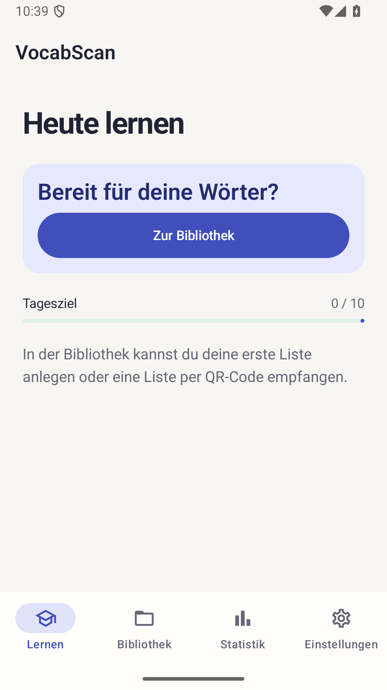
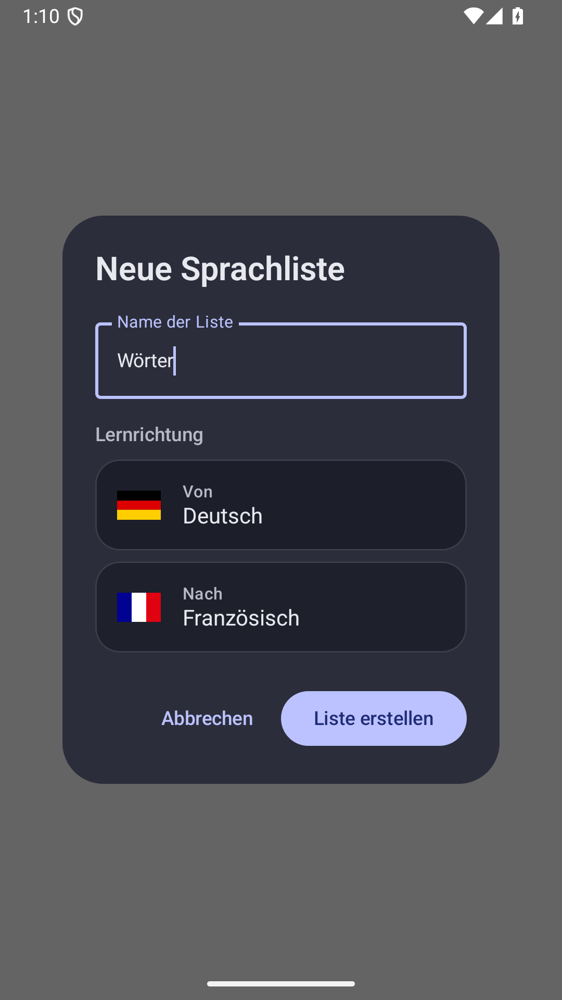

# VocabScan

**Vom Arbeitsblatt direkt in die Lernrunde.**

Android 8.0+ · Deutsch, Englisch & Französisch · Hell & Dunkel · ohne Konto

[📥 Installation](#installation) · [Screenshots](#screenshots) · [Funktionen](#funktionen)

---

## Screenshots

<table>
  <tr>
    <td align="center" width="50%"><strong>Lernen</strong></td>
    <td align="center" width="50%"><strong>Sprachen kombinieren</strong></td>
  </tr>
  <tr>
    <td align="center"></td>
    <td align="center"></td>
  </tr>
  <tr>
    <td align="center"><strong>Importieren</strong></td>
    <td align="center"><strong>Lernkarten</strong></td>
  </tr>
  <tr>
    <td align="center"></td>
    <td align="center"></td>
  </tr>
</table>

Inhalte sind Beispieldaten

---

## Funktionen

### 📷 Scannen
- Arbeitsblatt fotografieren oder Bild importieren
- Zwei Spalten werden automatisch zu Wortpaaren
- Vor dem Speichern prüfen und korrigieren
- Originalseiten bleiben in der Liste erhalten
- Am besten mit gedruckten Zwei-Spalten-Tabellen (Handschrift braucht mehr Nacharbeit)

### 🧠 Lernen
- Antwort eintippen oder Karte umdrehen
- Vorwärts, rückwärts oder gemischt
- Wiederholungsabstände nach deiner Bewertung, getrennt pro Richtung
- Runden nach fälligen Karten, neuen Wörtern oder Favoriten
- Auswahl nach Liste, Kapitel oder Tag
- Tagesziel, Statistik, Lernkalender und tägliche Erinnerung

### 🌍 Sprachen
- Deutsch, Englisch und Französisch frei kombinierbar
- Gleiche Sprache auf beiden Seiten: Begriffe mit Erklärungen oder Synonymen
- Notizen und weitere erlaubte Antworten pro Vokabel
- Toleranz bei kleinen Tippfehlern
- Aussprache über die Android-Sprachausgabe
- Allgemeine Lernkarten (Begriff + Erklärung) für beliebige Themen

### 🗂️ Organisieren
- Listen, Ordner, Kapitel und Tags
- Favoriten und Archiv
- Suche in der Bibliothek

### 🤝 Teilen & Sichern
- **QR-Code** (auch mehrere für große Listen) oder **CSV**: nur Listen, ohne Lernverlauf
- **ZIP-Export**: komplette Sicherung inkl. Lernstände, Bewertungen und Scanbilder

### 🔒 Datenschutz
- Alle Daten lokal gespeichert, kein Konto nötig
- Texterkennung auf dem Gerät
- Kein dauerhaftes Internet nötig

<strong>Hinweise</strong>

- Dokumenten- und QR-Scanner benötigen Google Play-Dienste (ggf. Download zusätzlicher Komponenten)
- Verfügbare Stimmen hängen von der installierten Sprachausgabe ab
- Beim Deinstallieren werden lokale Daten gelöscht, daher vorher als ZIP sichern
- Wiederherstellen ersetzt den aktuellen Datenbestand
- ZIP-Sicherung ist unverschlüsselt

---

## 📥 Installation

1. Neueste Version unter **Releases** öffnen
2. APK unter **Assets** herunterladen
3. Datei öffnen und Installation aus dieser Quelle erlauben
4. Installieren und erste Liste anlegen

Voraussetzung: **Android 8.0+**. Updates ebenfalls über Releases, einfach über die vorhandene App installieren.

---

## 💬 Feedback

**Issue** im Repository erstellen, am besten mit Android-Version und kurzer Beschreibung der Schritte. Bei Scanner-Problemen gern einen anonymisierten Ausschnitt des Arbeitsblatts anhängen.

## Entwicklung

Android-Projekt mit Kotlin, Jetpack Compose und Material 3. Build-Voraussetzungen,
lokale Prüfungen und die vorhandenen GitHub Actions sind in [RELEASE.md](RELEASE.md)
beschrieben. **VocabScan DEV** ist parallel zur Release-App installierbar; Releases
werden ausschließlich im eingerichteten GitHub-Workflow signiert.
