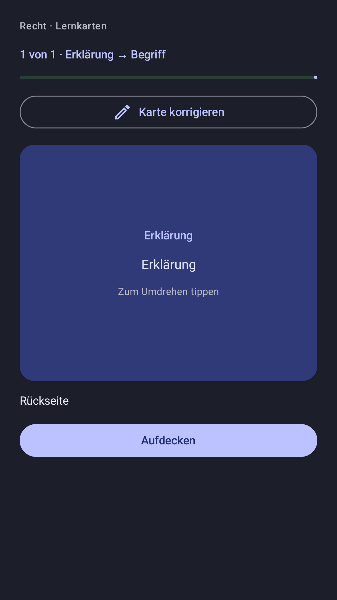

# VocabScan

**Vokabelliste fotografieren. Wörter prüfen. Loslernen.**

Arbeitsblätter in Lernkarten verwandeln und Vokabeln gezielt wiederholen – auf deinem Android-Gerät, ohne Konto.

Android 8.0+ · Deutsch, Englisch, Französisch & Latein · Hell- und Dunkelmodus

[Installation](#installation) · [Screenshots](#screenshots) · [Alle Funktionen](#funktionen)

## Das Wichtigste

- **Weniger abtippen:** Gedruckte Vokabellisten scannen oder als Bild importieren. Erkannte Wortpaare vor dem Speichern korrigieren.
- **Passend wiederholen:** Die App plant Wiederholungen nach deiner Bewertung – für jede Lernrichtung getrennt.
- **So lernen, wie es dir hilft:** Antworten eintippen oder Lernkarten umdrehen. Auch Begriffe und Erklärungen für andere Fächer sind möglich.
- **Listen weitergeben:** Per QR-Code oder CSV teilen; mit einer ZIP-Sicherung auch Lernstände und Scanbilder mitnehmen.
- **Ohne Konto lernen:** Deine Lerndaten bleiben auf dem Gerät. Texterkennung und Lernen funktionieren lokal.

## Screenshots

<table>
  <tr>
    <th width="25%">Liste anlegen</th>
    <th width="25%">Importieren</th>
    <th width="25%">Lernrunde starten</th>
    <th width="25%">Karten üben</th>
  </tr>
  <tr>
    <td align="center"></td>
    <td align="center"></td>
    <td align="center"></td>
    <td align="center"></td>
  </tr>
</table>

Zum Vergrößern anklicken. Alle Inhalte sind Beispieldaten.

## Installation

1. **[Aktuelle APK herunterladen](https://github.com/KingMezzo/vocabScan/releases/latest/download/vocabscan.apk)** – benötigt Android 8.0 oder neuer.
2. Die heruntergeladene Datei öffnen und Android bei Nachfrage die Installation aus dieser Quelle erlauben.
3. VocabScan installieren, eine Liste anlegen und Wörter scannen oder selbst eintragen.

**Updates:** In den Einstellungen kannst du nach neuen Versionen suchen und die automatische Updateprüfung ein- oder ausschalten. Alternativ die neueste APK über die vorhandene App installieren; deine Daten bleiben dabei erhalten.

Die Downloadzahlen oben werden von Shields.io aus den GitHub-Releases geladen. Sie zählen Downloads von Release-Dateien, keine installierten Apps. Die Anzeige kann durch Zwischenspeicherung verzögert sein.

## Funktionen

### Scannen & Erfassen

- Arbeitsblätter fotografieren oder vorhandene Bilder importieren.
- Zwei Spalten automatisch als Wortpaare erkennen lassen.
- Erkannte Wörter und Zuordnungen vor dem Speichern prüfen und korrigieren.
- Originalseiten in der Liste behalten und später nachsehen.
- Vokabeln und eigene Lernkarten auch von Hand anlegen und bearbeiten.

Am besten klappt die Erkennung mit **gedruckten Zwei-Spalten-Tabellen**. Handschrift braucht mehr Nacharbeit.

### Lernen & Wiederholen

- Antworten eintippen oder Karten umdrehen und selbst bewerten.
- Vorwärts, rückwärts oder in gemischter Richtung üben.
- Wiederholungsabstände nach deiner Bewertung planen lassen; der Lernstand wird pro Richtung geführt.
- Runden mit fälligen Karten, neuen Wörtern oder Favoriten zusammenstellen.
- Nach Liste, Kapitel oder Tag auswählen, was du üben möchtest.
- Tagesziel setzen, Statistik und Lernkalender ansehen, tägliche Erinnerung einstellen.

### Sprachen & Eigene Inhalte

- Deutsch, Englisch, Französisch und Latein auf beiden Seiten einer Liste frei kombinieren.
- Dieselbe Sprache auf beiden Seiten nutzen, etwa für Synonyme oder Begriffserklärungen.
- Allgemeine Lernkarten für beliebige Themen anlegen.
- Notizen und zusätzliche erlaubte Antworten pro Vokabel hinterlegen.
- Kleine Tippfehler bei der Antwortprüfung tolerieren lassen.
- Wörter über die Android-Sprachausgabe anhören, sofern eine passende Stimme installiert ist.

### Listen organisieren

- Listen in Ordnern ablegen und mit Kapiteln und Tags gliedern.
- Wichtige Wörter als Favoriten markieren.
- Nicht mehr benötigte Listen archivieren.
- In der Bibliothek suchen.

### Teilen & Sichern

| Format | Wofür? | Enthalten |
| --- | --- | --- |
| **QR-Code** | Eine Liste direkt weitergeben; große Listen über mehrere Codes | Liste ohne Lernverlauf |
| **CSV** | Listen als Datei importieren, exportieren oder teilen | Karten und Notizen, ohne Lernstände und Bilder |
| **ZIP** | Vollständige Sicherung oder Umzug auf ein anderes Gerät | Listen, Lernstände, Bewertungen und Scanbilder |

**Vor dem Deinstallieren als ZIP sichern:** Beim Deinstallieren werden die lokalen Daten gelöscht. Eine Wiederherstellung ersetzt den aktuellen Datenbestand; ZIP-Sicherungen sind unverschlüsselt.

Datenschutz & technische Hinweise

- Kein Konto nötig; Lerndaten werden lokal gespeichert.
- Die Texterkennung läuft auf dem Gerät. Zum Lernen ist keine dauerhafte Internetverbindung nötig.
- Dokumenten- und QR-Scanner benötigen Google Play-Dienste. Für zusätzliche Scanner-Komponenten kann ein Download nötig sein.
- Verfügbare Sprachen und Stimmen der Aussprache hängen von der installierten Android-Sprachausgabe ab.
- Die Updateprüfung und der Download neuer Versionen benötigen Internet. Die automatische Prüfung lässt sich in den Einstellungen ausschalten.

Fehler melden & Wünsche vorschlagen

[Issue erstellen](https://github.com/KingMezzo/vocabScan/issues) und kurz beschreiben, was passiert ist oder welche Funktion fehlt. Bei Fehlern helfen die Android-Version und die Schritte zum Nachstellen. Bei Scanner-Problemen kannst du einen anonymisierten Ausschnitt des Arbeitsblatts anhängen.

Für Entwickler

Kotlin, Jetpack Compose und Material 3. Die bestehenden Workflows für [CI](.github/workflows/ci.yml) und [Release-Builds](.github/workflows/release.yml) liegen im Repository. Releases werden in GitHub Actions signiert; **VocabScan DEV** lässt sich parallel zur Release-App installieren.

