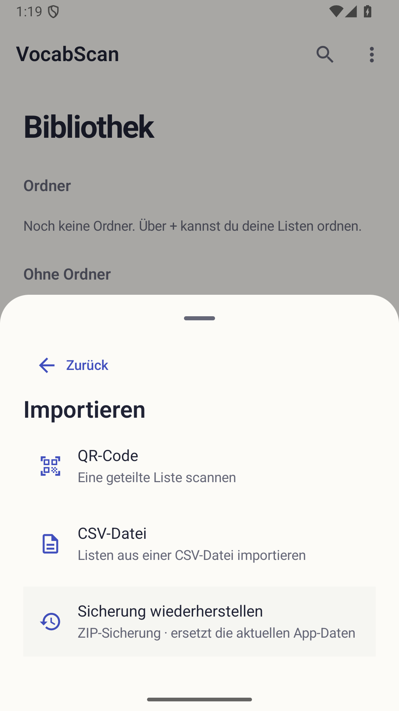

# VocabScan

### Vom Arbeitsblatt direkt in die Lernrunde.

Vokabeln scannen, eigene Karten anlegen und regelmäßig wiederholen. 
Mit deinen eigenen Inhalten und ohne Benutzerkonto.

**Android 8.0+ &nbsp; · &nbsp; Deutsch, Englisch & Französisch &nbsp; · &nbsp; Hell & Dunkel**

[**📥 Zur Installation**](#installation) &nbsp; · &nbsp; [Bilder ansehen](#ein-blick-in-die-app) &nbsp; · &nbsp; [Funktionen entdecken](#funktionen)

---

Die nächste Vokabelliste liegt schon auf dem Tisch? Mit **VocabScan** scannst du sie ein, prüfst die erkannten Wörter und kannst direkt loslernen. Für Definitionen, Fachbegriffe und andere Themen legst du eigene Lernkarten an.

| 📷 Weniger abtippen | 🗂️ Deinen Lernstoff ordnen | 🧠 Regelmäßig wiederholen |
| :--- | :--- | :--- |
| Arbeitsblatt scannen und Wortpaare prüfen | Eigene Listen, Ordner und Favoriten | Kurze Runden mit passenden Wiederholungsabständen |

## Ein Blick in die App

<table>
  <tr>
    <td align="center" width="50%"><strong>Lernen im Alltag</strong></td>
    <td align="center" width="50%"><strong>Sprachen frei kombinieren</strong></td>
  </tr>
  <tr>
    <td align="center"></td>
    <td align="center"></td>
  </tr>
  <tr>
    <td align="center"><strong>Listen übernehmen</strong></td>
    <td align="center"><strong>Mit Lernkarten üben</strong></td>
  </tr>
  <tr>
    <td align="center"></td>
    <td align="center"></td>
  </tr>
</table>

Einblicke in den Hell- und Dunkelmodus · Inhalte sind Beispieldaten

---

## 📷 Scannen statt alles abtippen

Fotografiere ein gedrucktes Arbeitsblatt oder importiere ein vorhandenes Bild. VocabScan erkennt die beiden Spalten deiner Vokabelliste und ordnet die Wortpaare zu. Vor dem Speichern kannst du alles mit dem Original vergleichen, Schreibfehler verbessern und falsch zugeordnete Zeilen korrigieren.

Die Originalseiten bleiben in deiner Liste erhalten, falls du später noch einmal nachsehen möchtest. Am besten funktioniert die Erkennung mit gut lesbaren, gedruckten Tabellen mit zwei Spalten. Handschrift und ungewöhnliche Seitenaufteilungen brauchen mehr Nacharbeit.

## 🧠 Lernen, wie es gerade passt

**Antwort eintippen oder Karte umdrehen:** Entscheide selbst, ob du die Übersetzung schreiben oder dich mit klassischen Lernkarten abfragen möchtest. Du kannst vorwärts, rückwärts oder in beide Richtungen gemischt üben.

**Schwierige Wörter öfter sehen:** Nach jeder Karte bewertest du, wie gut du die Antwort wusstest. Daraus plant die App die nächsten Wiederholungen. Was noch nicht sitzt, kommt früher wieder; sichere Karten bekommen mehr Abstand. Beide Lernrichtungen werden getrennt berücksichtigt.

**Die passende Runde zusammenstellen:** Übe fällige Karten, neue Wörter oder gezielt deine Favoriten. Wähle einzelne Listen, Kapitel oder Tags aus, wenn du dich auf ein bestimmtes Thema vorbereiten willst.

## 🌍 Drei Sprachen, frei kombiniert

Deutsch, Englisch und Französisch lassen sich beliebig als Ausgangs- und Zielsprache wählen. Auch Englisch → Französisch oder Französisch → Englisch sind möglich. Wählst du auf beiden Seiten dieselbe Sprache, kannst du Begriffe mit Erklärungen oder Synonymen lernen.

Zu deinen Vokabeln kannst du Notizen und weitere erlaubte Antworten hinterlegen. Im Eingabemodus berücksichtigt die App diese Varianten und gibt auch bei kleinen Schreibabweichungen Rückmeldung. Die Aussprache beider Seiten lässt sich über die auf dem Gerät installierte Sprachausgabe anhören.

### Nicht nur für Fremdsprachen

Definitionen, Fachbegriffe oder Prüfungswissen: Allgemeine Lernkarten bestehen aus einem Begriff und einer Erklärung und sind an keine Sprache gebunden. Du kannst sie selbst schreiben oder aus Text und CSV übernehmen. Wiederholungen, Tagesziel und Statistik funktionieren auch für diese Karten.

## 🗂️ Alles an seinem Platz

- **Listen und Ordner:** Sortiere deinen Lernstoff nach Fach, Thema oder Schuljahr.
- **Kapitel und Tags:** Unterteile größere Listen und übe genau den Teil, den du gerade brauchst.
- **Favoriten:** Merke dir Wörter und Karten, auf die du später zurückkommen möchtest.
- **Archiv:** Pausiere abgeschlossene Listen. Inhalte und Lernstände bleiben erhalten.
- **Suche:** Finde Listen und Vokabeln in deiner Bibliothek wieder.

### Dein Fortschritt im Blick

Setze dir ein Tagesziel und starte im Bereich **Lernen** direkt mit der nächsten Runde. Danach siehst du, wie die Runde gelaufen ist und wann die geübten Karten wieder anstehen.

Statistik und Lernkalender zeigen deine Aktivität über die Zeit. Wenn du möchtest, erinnert dich die App täglich an fällige Karten.

## 🤝 Teilen und mitnehmen

Eine Liste mit anderen lernen? Teile sie per **QR-Code** oder als **CSV-Datei**. Größere Listen verteilt die App auf mehrere QR-Codes. Auf dem anderen Gerät werden sie wieder zu einer Liste zusammengesetzt.

Für einen Gerätewechsel oder eine Sicherung gibt es den **vollständigen ZIP-Export**. Er enthält auch deine Lernstände, Bewertungen und gespeicherten Scanbilder. CSV und QR-Codes übertragen die Listen ohne Lernverlauf.

## 🔒 Deine Daten bleiben bei dir

VocabScan speichert deine Lerninhalte lokal und benötigt kein Benutzerkonto. Auch die Texterkennung findet auf dem Gerät statt. Zum Lernen brauchst du keine dauerhafte Internetverbindung.

<strong>Hinweise zu Scanner, Aussprache und Sicherungen</strong>

Der Dokumenten- und der QR-Scanner benötigen Google Play-Dienste. Bei der ersten Nutzung werden gegebenenfalls zusätzliche Komponenten heruntergeladen. Die verfügbaren Stimmen für die Aussprache hängen von der installierten Android-Sprachausgabe ab.

Sichere deine Daten vor einem Gerätewechsel oder einer Deinstallation als ZIP-Datei. Beim Deinstallieren werden die lokalen App-Daten gelöscht. Das Wiederherstellen einer Sicherung ersetzt den aktuellen Datenbestand. Die Sicherungsdatei enthält deine Lerninhalte unverschlüsselt.

---

## 📥 VocabScan installieren

VocabScan bekommst du hier auf GitHub als APK-Datei unter **Releases**.

1. Öffne die neueste Veröffentlichung unter **Releases**.
2. Lade die **APK-Datei** im Abschnitt **Assets** herunter.
3. Öffne die Datei auf deinem Android-Gerät. Erlaube bei der Nachfrage die Installation aus dieser Quelle.
4. Installiere VocabScan und lege deine erste Liste an.

Du brauchst **Android 8.0 oder neuer**. Neue Versionen findest du ebenfalls unter **Releases** und installierst sie über die vorhandene App.

---

## 💬 Fragen oder einen Fehler gefunden?

Schreib gern ein **Issue** hier im Repository. Wenn etwas nicht funktioniert, helfen deine Android-Version und eine kurze Beschreibung der Schritte. Bei Problemen mit dem Scanner kannst du einen anonymisierten Ausschnitt des Arbeitsblatts ergänzen.
